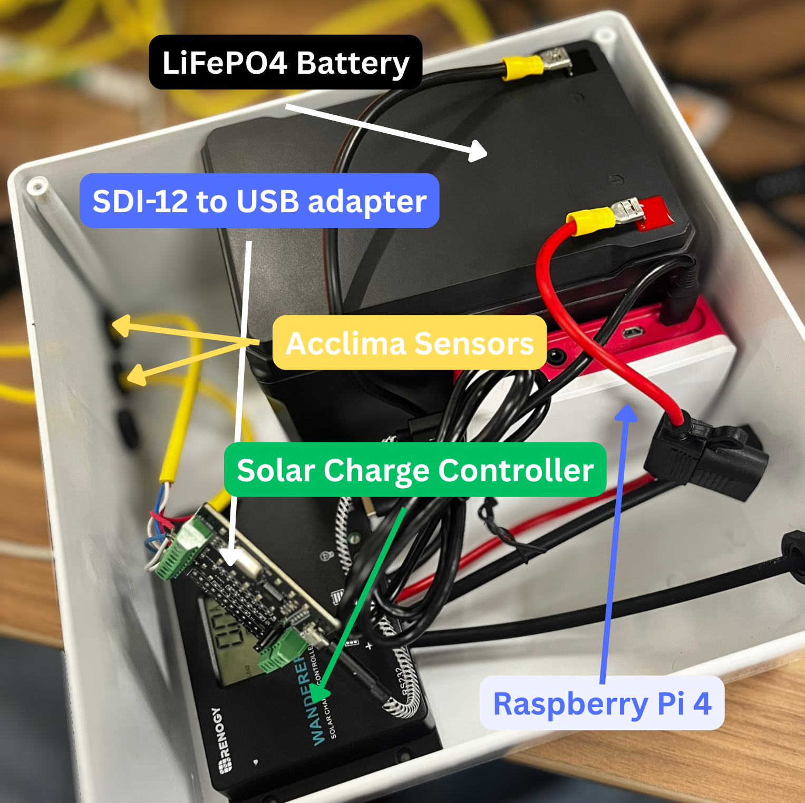

# Datalogger

These are the files you'll place on the datalogger. The scripts assume you are using a Raspberry Pi Model 4B running Raspbian.

## Datalogger internals



These are the internals of the datalogger. A solar panel charges a LiFePO4 battery, which is controlled by the Solar Charge Controller. Acclima sensors are inserted into the SDI-12 to USB adapter which is periodically queried by the Raspberry Pi 4. The Raspberry Pi 4 intermittently searches for the desired AP. If it detects it, it connects, sends a POST request with the soil data, then disconnects.

## Get started

Assuming you have Raspbian already installed on your Pi, you'll first clone the repo,

```bash
git clone https://github.com/grayzing/daf-rpi-datalogger.git
cd daf-rpi-datalogger/scripts/datalogger
```

then you simply run the script to set up the accumulation service

```bash
bash setup.sh
```

## Features

This script features automatic detection of sensor addresses. Assuming all sensors in your inventory have distinct addresses, there's no need to manually set addresses to query, it's simply "plug-and-play."